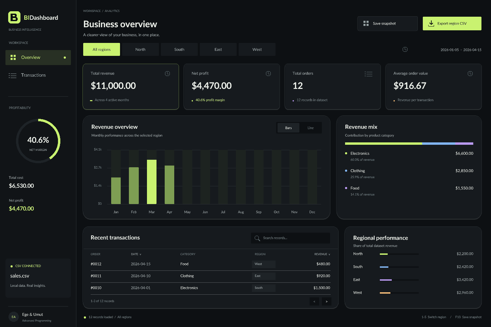

# BIDashboard | Business Intelligence Dashboard

A desktop Business Intelligence Dashboard prototype developed in **C** using the **raylib** graphics library.



## Project Overview

This project is being developed as part of the Advanced Programming AI Project.

The application will visualize business data through an interactive dashboard, allowing users to monitor key performance indicators (KPIs), explore charts, and analyse sales performance.

## Features

- Dashboard interface built with raylib
- CSV data loading
- Revenue, Profit and Orders KPIs
- Monthly sales charts
- Category and region analysis
- Interactive filtering
- Charcoal theme, Lato typography, and lime accents
- Profit margin ring and regional revenue comparison
- Monthly bar/line chart with hover values
- Transaction search, date/revenue sorting, and pagination
- Region CSV export and PNG dashboard snapshots
- Resizable desktop UI with aligned input coordinates

## Technologies

- C
- raylib
- Git & GitHub

## Project Structure

```text
src/        Source code
data/       CSV datasets
assets/     Images, icons, fonts
docs/       Development journal and documentation
```

## Team

- Ege Aksoy
- Umut Ali Yalcin

## Status

The dashboard displays CSV-backed KPI cards, a 12-month revenue chart, dynamic
category contribution charts, and region buttons. Selecting a region updates all metrics and
charts using the backend calculation functions.

## Build and run

Requires CMake 3.16+, Git, and a C11 compiler (Visual Studio Build Tools,
MinGW, GCC, or Clang). CMake uses installed raylib 5.5 when available, otherwise
downloads raylib 5.5 on the first configure (internet access required).

```sh
cmake -S . -B build
cmake --build build --config Release
```

Run from the repository root so the application can read `data/sales.csv`.
On Windows with Visual Studio, run `build/Release/bi_dashboard.exe`.
With a single-configuration generator, run `build/bi_dashboard` (or
`build/bi_dashboard.exe` on Windows). `make` is an optional wrapper for the
same CMake commands.

## UI integration

`src/main.c` owns the window, `DashboardViewData`, and selected `RegionFilter`.
`src/data.h` owns the backend `DashboardStats` definition (double precision).

`src/dashboard.h` wraps it in `DashboardViewData` with 12 monthly values,
backend category records, and a category count, and exposes drawing functions;
`src/dashboard.c` only renders those values and handles region button clicks.
The CSV is loaded once at startup. Input is processed before drawing, and backend
filtering and calculations run initially and whenever the selected region changes.
No CSV processing or business calculations belong in drawing code.

## Controls

- Select a region using the chips, a regional comparison row, or keys 1-5.
- Switch the monthly chart between Bars and Line. Hover to inspect exact values.
- Open Transactions for the full record explorer. Search by ID, date, category,
  or region. Click DATE or REVENUE to toggle sorting; use arrows for pagination.
- Search accepts typing and Ctrl+V. Delete clears the query; Escape clears it and
  leaves the search field. Searching changes the table, not the dashboard KPIs.
- Export region CSV saves all records in the selected region, independent of the
  table search. Reports use unique names under exports/ and are excluded from Git.
- Save snapshot (or F10) saves a PNG to exports/. Close using the window's close button.

The initial canvas is 1440 x 960 and scales uniformly when resized. The CSV is
read only once. Margin, revenue shares, date bounds, and regional summaries are
prepared by the controller, using the backend's calculations. No growth claims
or simulated historical comparisons are displayed. Fonts and their OFL license
are bundled under assets/fonts/.

The original BIDashboard monogram is available as a scalable SVG in
assets/branding/bidashboard-mark.svg. The sidebar and native window icon use
the same Raylib geometry, so branding does not require another image library.
